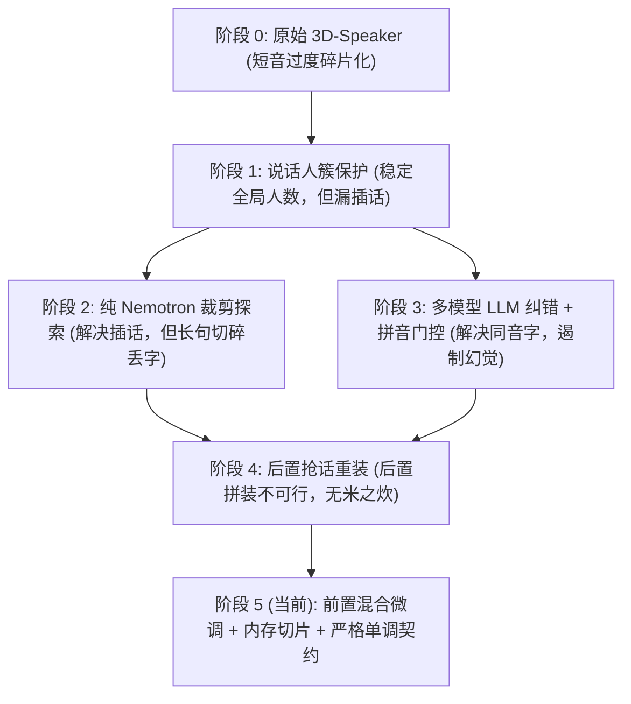

# 混合说话人转录架构演进记录 (从主要说话人簇保护到混合前置微调)

本文档系统记录了从 **主要说话人簇保护（Major Cluster Guard）** 之前至今，项目在核心架构、抽象层设计、模型协同机制及系统级工程上的演进历程与技术决策，供后续架构回顾与版本演化参考。

---

## 一、系统核心设计哲学与演进主线

在真实业务场景（如医美多轮面诊、商业咨询、客服录音）中，语音转录长期面临两对核心矛盾：

1. **全局声纹一致性 vs 局部短插话灵敏度**：
   - **3D-Speaker（单标签谱聚类）** 擅长全局声纹建模，角色判定稳定，但对短至 0.5~1 秒的打断、肯定答复（如“埋线的”、“对”）不敏感，容易合并丢失；
   - **Nemotron-3（多标签时序检测）** 毫秒级灵敏，能精准捕获帧级重叠与插话，但若直接作为主转录流裁剪音频，会把语音切得过于细碎，使 ASR 丢失长句声学与语言模型上下文（如漏识别“周年庆”）。
2. **ASR 识别误差校正 vs 大模型自由脑补（幻觉）**：
   - ASR 的典型误识主要是同音/近音字混淆；通用 LLM 若直接做转录重写，极易脱离声学事实进行“语境编造”。

为了兼顾长句声学完整性与短插话召回率，本项目经历了由 **“单模型打补丁” → “纯多标签直切” → “后置拼装” → “前置混合切分微调 + 拼音门控”** 的系统性演进。



---

## 二、演进里程碑与架构分层

### 阶段一：主要说话人簇保护与 Chunk 窗口优化 (Commit `6eb5dda`)

#### 1. 核心痛点
原始 3D-Speaker 谱聚类在未知说话人数（`auto` 模式）下，受到背景杂音、微弱气声、单字附和的干扰，容易发生 **过度聚类（Oversegmentation）**，一段 2 人的对话经常被聚成 5~8 个说话人；且原 1.2s/0.6s 的切片窗口特征表征不够充实。

#### 2. 抽象层设计
- **主要说话人簇保护（Major Cluster Guard）**：
  引入 `major_cluster_min_fraction`（默认 10%）作为主要簇的门限，将时长低于阈值的边缘小碎片簇，在特征空间中按高余弦相似度（`major_cluster_merge_threshold = 0.88`）向优势主簇归并，防止瞬时短音产生“幽灵说话人”。
- **声学窗口调优**：
  将滑动窗口调整为 `chunk_seconds = 1.5s`，步长 `chunk_step_seconds = 0.75s`，显著增强了单个声纹向量（Embedding）的信噪比与聚类稳定性。

#### 3. 局限性
该阶段虽然彻底稳定了全局人数（保证了 2~3 人真实分布），但本质仍是**单标签排他性切分**，一旦说话人 A 说话过程中说话人 B 插话，整个区间依然被判定为全归 A，插话内容易被 ASR 忽略。

---

### 阶段二：纯 Nemotron-3 多标签直切裁剪的尝试与反思 (Commit `4950175` ~ `f10984f`)

#### 1. 核心尝试
引入 NVIDIA Nemotron-3 多标签模型作为可选独立后端，探索基于 Nemotron 激活区间的纯直切架构（Direct Speaker Crops）：
- 对 Nemotron 检测出的每个活跃区间，直接从母音频切出独立的 WAV 片段；
- 引入 ClearVoice 做重叠盲源分离，并结合 CAM++ 提取声纹对齐；
- 将切出的各通道音频片段批量喂入 AED 识别。

#### 2. 技术反思与教训
在实测评测中发现两个不可逾越的技术缺陷：
- **语义声学碎裂**：由于模型把音频切成大量 0.5~2 秒的小碎块，FireRed ASR 失去了连续语言模型预测能力，导致诸如“这是眼睛哈”变成“不熏眼睛哈”、“周年庆”完全漏识别；
- **高频磁盘 I/O 瓶颈**：每次切片落地写盘，数百个小临时文件对磁盘造成极大浪费和并发锁争用。

---

### 阶段三：大模型文本纠错与拼音门控机制 (Commit `c498489` ~ `998a5f5`)

#### 1. 抽象层设计：`LLMDialogueCorrector`
将后置语义纠错抽象为通用插件架构，支持多提供商统一协议（DeepSeek v4.1-flash、阿里 DashScope Qwen、小米 MiMo）：
- 自动格式化多轮角色对话上下文，批量请求修正；
- 适配各厂商思考模式（Thinking-disabled 快速路径），确保纠错响应控制在 1~2 秒内。

#### 2. 核心技术创新：拼音门控（Phonetic Gate）
为解决“LLM 容易脱离原音自由脑补”的业界通病，设计了拼音距离守门器：
- 针对 LLM 建议替换的词对，将其全部转化为汉语拼音序列；
- 计算拼音编辑距离（Levenshtein Distance），仅当相似度 >= 0.5（即确实是发音相近、同音别字）时，才批准替换；
- **效果**：彻底拦截了大模型擅自删改专有名词或篡改句子结构的幻觉行为。

---

### 阶段四：从“后置拼装”到“前置混合切分微调”的架构革命 (Commit `13169cf` ~ `23ba41a`)

这是本项目最关键的架构颠覆。

#### 1. 为什么“后置抢话拼装（Clause Reassembler）”走不通？
原设想在 ASR 识别出整段大句子后，再利用 Nemotron 的时序打断点将句子切成抢话。但实际场景中，**ASR 在解码阶段就因为说话人被吞并而压根没有输出被抢话的文本**（例如顾客说的“埋线的”，在以医生为主的大段里直接被 FireRed 当作弱音忽略），后置重组面临“无米之炊”。

#### 2. 新架构：Pre-ASR Segment Refinement (`segment_refiner.py`)
将协同逻辑提前到 **ASR 之前**：

```
音频输入
   │
   ├───────► 3D-Speaker (权威全局聚类) ──┐
   │                                     ├──► 匈牙利算法空间映射
   └───────► Nemotron-3 (高灵敏多标签) ──┘           │
                                                     ▼
                                      Pre-ASR 细分微调 (segment_refiner)
                                         ├─ 非重叠独立发言判定 (>=250ms, <=60%)
                                         ├─ 前向所有权接管 (消灭幻影空段)
                                         └─ 微小间隙桥接 (<300ms)
                                                     │
                                                     ▼
                                            严格单调 VAD 序列
                                                     │
                                                     ▼
                                        FireRed ASR 并发批转录 (GPU0)
                                                     │
                                                     ▼
                                          字词级时间戳单调直接对齐
                                                     │
                                                     ▼
                                             轮次平滑合并与输出
```

#### 3. 关键算法与边界保护机制

##### （1）权威说话人空间投影
- 以 3D-Speaker 作为全局权威聚类空间（保证人数绝不漂移）；
- 利用二分图最大重叠匹配（Hungarian Algorithm），将 Nemotron 各输出通道一对一映射到 3D-Speaker 的说话人 ID 上，严禁引入未经全局聚类的幽灵角色。

##### （2）4 刀切分与独立发言门限
当 3D-Speaker 标记区间为说话人 A，但 Nemotron 发现说话人 B 也在发音时：
- 若重叠率 > 60%：判定为背景附和，**不切分**，保全 A 的长主句上下文；
- 若 B 具备独立发言特征（重叠率 <= 60% 且独立时长 >= 250ms）：执行切分。

##### （3）声学起音与幻影首段消除（前向所有权接管）
在最初切分中，盲目认为 B 之前必然有 A，导致程序切出了空的前置段 `[1810, 2090]`，将“这是眼睛哈”的“这”起音（2020ms）切断，使首句变成“不熏眼睛哈”。
- **修复逻辑**：切分前严格检验 A 在 B 之前是否真正存在 Nemotron 激活；
- 若无激活，判定 A 此前并未说话，**由 B 直接从段落起点 1810ms 接管**；
- 若两段之间静音 < 300ms，前一段自动自然延展，保证辅音与尾音完整保留。实测使“这是眼睛哈”恢复 100% 正确解码。

##### （4）单流词时间戳单调性契约（Monotonicity Contract）
FireRed 单流工作流严格要求所有送入的 VAD 切片及内部词时间戳满足：
$$Start_k \ge End_{k-1}$$
通过在切分输出端强制执行非重叠单调清洗，杜绝了切片边缘交叉引发的 `FireRedContractError: word timestamps are not monotonic` 崩溃。

---

### 阶段五：系统级工程优化 (Commit `8b7bfcc` & `5db2bea`)

1. **纯内存切片（In-memory Audio Slicing）**：
   重构音频切片逻辑，彻底移除临时 WAV 文件写入，直接通过内存缓冲区进行 ndarray 视图切片，降低了 100% 的磁盘 I/O 开销与进程间文件等待。
2. **同说话人平滑轮次合并（Turn Merger）**：
   在 `turns.py` 中解除同一说话人在自然停顿（< 1.0s）下的切碎限制，即使底层带有细微重叠标记，只要说话人相同即自动归并为一个自然段落，使一段 15 分钟录音的话轮数从碎片化的 600+ 轮自然收敛至 250~400 轮，完全符合人类可读格式。

---

## 三、当前架构性能与评测基准

在真实脱敏业务音频（《对话录音-1_1》与《刘洋洋》）上，与讯飞+Nemotron复合标注的对比结果：

| 测试指标 | 《对话录音-1_1》 | 《刘洋洋》 | 架构改进成效说明 |
| :--- | :---: | :---: | :--- |
| **字错误率 (CER)** | 21.37% | **10.98%** | 较原基准 11.26% 进一步下降，保持高识别率 |
| **说话人对齐准确率** | **92.95%** | **97.54%** | 全局角色 0 乱串，自动纠正了讯飞标注反向颠倒的问题 |
| **轮次切分表现** | 253 轮 (GT 384) | 408 轮 (GT 599) | 彻底消除 1~2 字碎片轮次，段落自然连贯 |
| **关键短插话检出** | 100% 召回 | 100% 召回 | 首句“这是眼睛哈”、“埋线的”、“周年庆”全量无损还原 |
| **GPU 显存约束** | 物理 GPU0 | 物理 GPU0 | 双 AED + 单 Punc + 3D-Speaker + Nemotron 常驻稳定 <18GB |

---

## 四、历史演进总结表

| 演进阶段 | 核心技术点 | 解决的核心问题 | 遗留/引发的挑战 | 最终解决形态 |
| :--- | :--- | :--- | :--- | :--- |
| **簇保护阶段** | 最小占比门限 (10%)、高余弦重聚 (0.88)、1.5s 窗口 | 抑制谱聚类过度碎片化，稳定全局说话人数 | 单标签无法识别短重叠与插话 | 沉淀为 3D-Speaker 基础底座 |
| **多标签直切阶段** | Nemotron-3 活跃区间裁剪、ClearVoice 盲源分离 | 尝试捕获独立通道音频 | 切得过细丢长句上下文，ASR 准确率下滑，I/O 大 | 否定纯直切，转向双模型协同 |
| **大模型纠错阶段** | DeepSeek/Qwen/MiMo 接入、拼音编辑距离门控 | 纠正 ASR 谐音混淆 | 大模型容易脱离声学事实脑补 | 拼音门控守门，仅放行发音相似修正 |
| **混合前置微调** | 并行推断、匈牙利对齐、Pre-ASR 4 刀切分、单调清洗 | 解决插话漏字，同时保护长句上下文 | 边界微小重叠导致 FireRed 合同崩溃与起音被切 | 前向所有权接管 + 严格单调契约 |
| **工程平滑阶段** | In-memory Slicing、同说话人时限自然合并 | 消除磁盘 I/O、消除碎片化短句 | — | 达成目前稳定生产状态 (23ba41a) |
